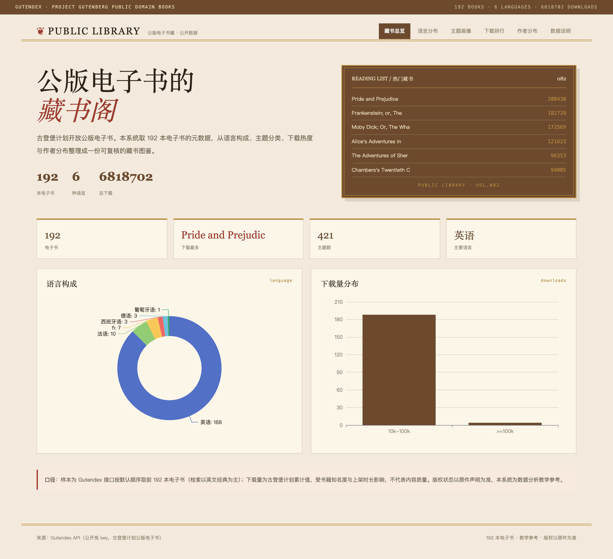
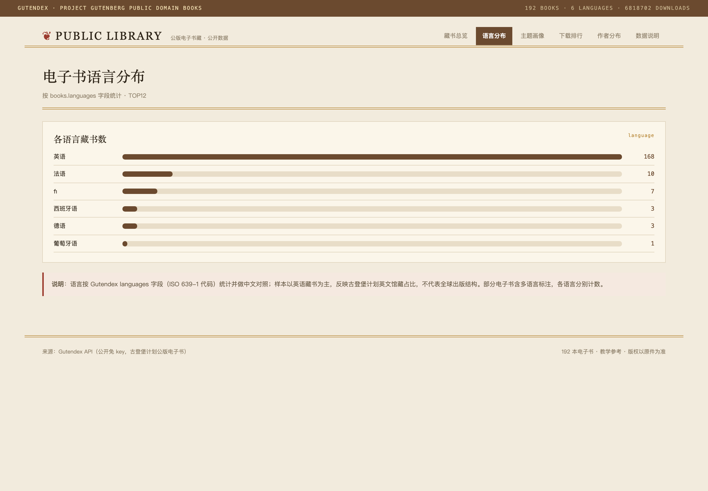
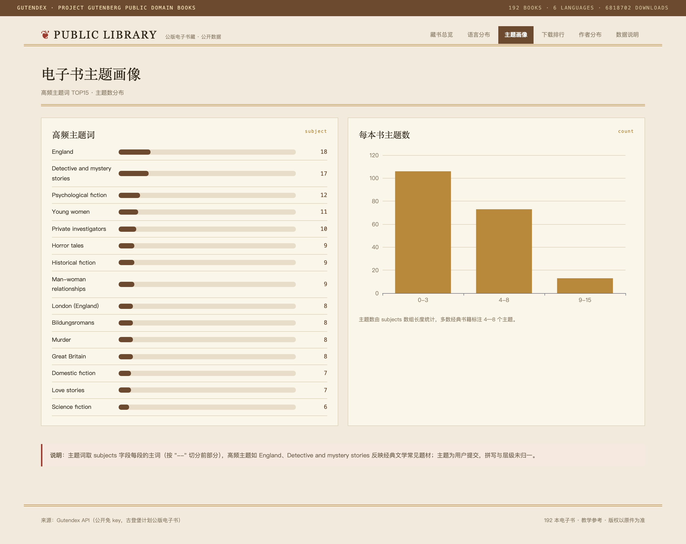
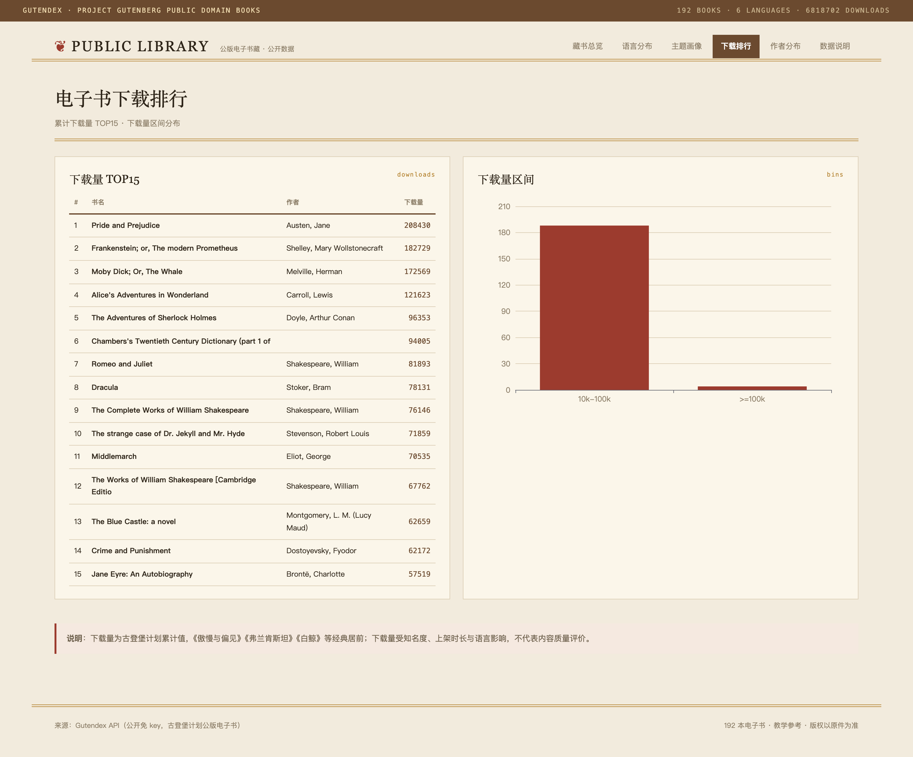
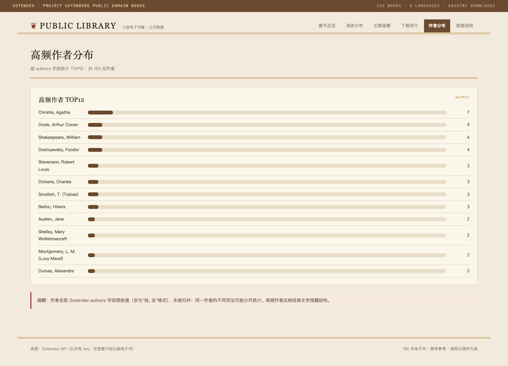
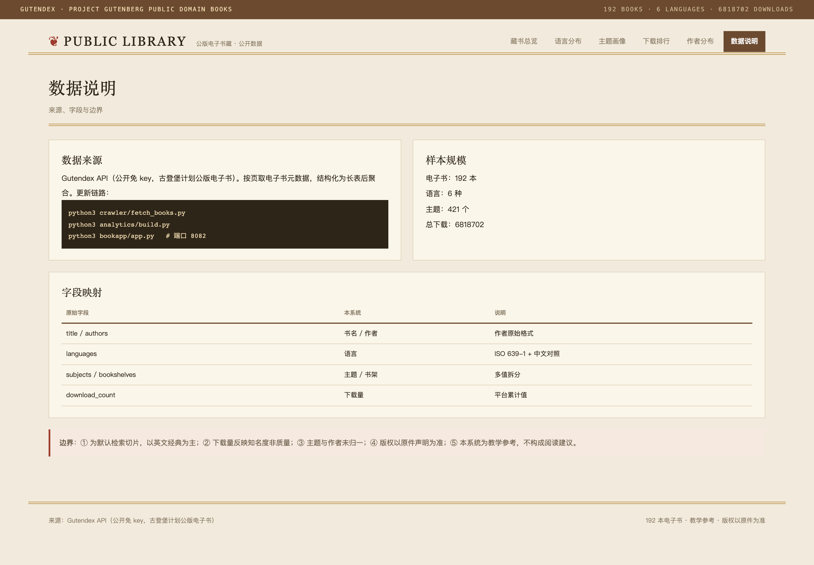

# 082 基于Gutendex公开数据的公版电子书分析系统-设计展示

> **代码有偿获取 可接受定制 微信联系方式: csbysj2020 或 ACE2487，备注(BS)**

> **完整源码与全套文档 · 在线自助获取 >>> [https://mbd.pub/o/bread/YZaWmJtpaA==](https://mbd.pub/o/bread/YZaWmJtpaA==)**

> **成品页（功能介绍 / 更多选题）>>> [https://bishe.suilang.net/products/public-library](https://bishe.suilang.net/products/public-library)**

> 

> 

## 视频

> **点击查看 >>> [https://www.bilibili.com/video/BV1KdyazcEpy/](https://www.bilibili.com/video/BV1KdyazcEpy/)**

## 项目简介

古籍书页风格（羊皮纸、墨棕、烫金、精装书封），区别于自然博物图鉴/调酒图鉴/奥运领奖台。采集 Gutendex 公开公版电子书 192 本（6 语言、421 主题），从语言、主题、下载与作者四维分析。Flask + ECharts（本地化离线可用），6 个页面。检索切片与下载量口径如实标注，版权以原件为准。

公版电子书是观察经典文学传播的数据窗口。

本项目设计并实现了一套基于 Gutendex 公开数据的电子书分析系统：通过分页接口获取 192 本电子书的元数据，结构化后从语言构成、主题分类、下载热度与作者分布四个维度聚合分析。

系统采用 Flask + ECharts 与古籍书页式界面（羊皮纸、墨棕、烫金、精装书封），实现藏书总览、语言分布、主题画像、下载排行、作者分布、数据说明 6 个页面。

本仓库为**设计展示**：包含项目说明、技术架构、实验结果与运行截图；完整源码、任务书、开题报告、毕业论文与使用说明可通过上方链接自助获取，成品页可查看更多选题，也可联系微信咨询定制。

## 功能特性

1. 差异化视觉：古籍书页（羊皮纸/墨棕/烫金/书封），非看板/画廊/博物图鉴

2. 真实采集：Gutendex API 公开免 key，192 本公版电子书

3. 语言画像：按 ISO 639-1 统计 6 种语言

4. 主题画像：高频主题词 TOP15 与主题数分布

5. 下载排行：累计下载量 TOP15 与区间分布

6. 作者分布：高频作者 TOP12

7. 技术栈差异化：Flask + ECharts（本地化）

8. 合规边界：检索切片、下载量非质量、版权以原件为准

## 技术架构

| 项目 | 说明 |
| --- | --- |
| 编程语言 | Python 3.8+ |
| Web 框架 | Flask（轻量路由，无 ORM） |
| 图表 | ECharts（本地化离线可用） |
| 数据源 | Gutendex API（公开免 key） |
| 样本规模 | 192 电子书 / 421 主题 |
| 运行端口 | http://127.0.0.1:8082 |
| 说明 | 数据直读 analysis JSON，无需数据库 |

## 目录结构

以下为完整交付版的结构（本仓库仅作设计展示）：

```
public-library/
├── analytics/
│   └── build.py
├── bookapp/
│   └── app.py
├── crawler/
│   └── fetch_books.py
├── data/
│   ├── analysis/
│   │   ├── authors.json
│   │   ├── download_bins.json
│   │   ├── languages.json
│   │   ├── shelves.json
│   │   ├── subject_bins.json
│   │   ├── subjects.json
│   │   └── top15.json
│   ├── processed/
│   │   └── books.csv
│   └── stats.json
├── static/
│   ├── css/
│   │   └── style.css
│   └── vendor/
│       └── echarts.min.js
├── templates/
│   ├── about.html
│   ├── authors.html
│   ├── base.html
│   ├── downloads.html
│   ├── languages.html
│   ├── overview.html
│   └── subjects.html
├── 任务书/
│   └── 毕业设计任务书.docx
├── 开题报告/
│   └── 毕业设计开题报告.docx
├── 最终论文/
│   ├── 图/
│   │   └── fig-arch.png
│   └── 基于Gutendex公开数据的公版电子书分析系统设计与实现.docx
├── 演示截图/
│   ├── 082-01-overview.png
│   ├── 082-02-languages.png
│   └── …
└── …
```

## 数据与实验结论

- 实验显示样本覆盖 6 种语言、421 个主题，累计 6818702 次下载，以英语经典为主。
- 真实采集：Gutendex API 公开免 key，192 本公版电子书
- 语言画像：按 ISO 639-1 统计 6 种语言
- 主题画像：高频主题词 TOP15 与主题数分布

## 交付内容

1. 完整源码（Flask 应用 + 采集器 + 分析引擎 + 6 页面）
2. 真实数据（books.csv + analysis JSON）
3. 任务书与开题报告（Word）
4. 毕业论文（Word 七章制）
5. 二次开发说明（Word+md）
6. 6 张截图 + 封面 + 演示视频

## 常见问题

**下载量代表书的质量吗？**

不代表，是平台累计值，受知名度与上架时长影响。

**主题统计准吗？**

主题为用户提交未归一，按主词统计，拼写差异会重复计数。

**这些书都无版权吗？**

以古登堡计划原件声明为准，本系统不构成版权判定。

**图表能离线用吗？**

能，echarts.min.js 已本地化到 static/vendor/。

## 截图







